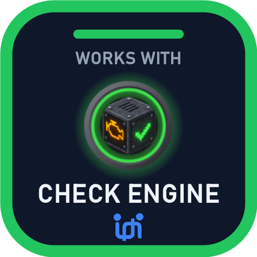

<p align="center"></p>

# Make your pack Check Engine ready

Add Check Engine to your pack and your players stop asking "why won't it start?". When something breaks, they see what's wrong and how to fix it, before the loading screen, after a crash, or when a mod goes missing.

It takes 2 minutes: drop the mod in, fill in one config file, add the badge.

## 1. Add the mod

Put the Check Engine jar in your pack's `mods` folder. It changes nothing in gameplay.

## 2. Fill in `config/checkengine-pack.properties`

The file appears after the first launch. Ship it with your pack.

| Line | What it does | Example |
| --- | --- | --- |
| `pack_name` | Your pack's name on Check Engine's screens ("Beyond the Crank won't start") | `pack_name=Beyond the Crank` |
| `support_link` | A "Get help" button that opens your Discord, issues page or mod page | `support_link=https://discord.gg/yourpack` |
| `recommended_ram` | Players who give the game far less memory get a heads-up | `recommended_ram=10G` |
| `quiet` | `true`: players only see Check Engine when something stops the game or it crashed | `quiet=false` |
| `hide_warnings` | Warnings your players don't need, by kind or by words in the title | `hide_warnings=same-job-mods, Xaero's Minimap` |

Things `hide_warnings` understands: `duplicate-mod`, `same-job-mods`, `downgraded-mod`, `settings` (the memory and Java windows), `update-notes` (the "pack was updated" screen), or any words from a warning's title. Problems that stop the game always show.

## 3. Add the badge to your pack page


CurseForge and Modrinth descriptions (HTML):

```html
<a href="https://github.com/Uanme37/CheckEngine"></a>
```

Markdown (GitHub, Modrinth):

```markdown
[](https://github.com/Uanme37/CheckEngine)
```

## What your players get

- **Before the loading screen:** a window when the pack won't start (missing mod, wrong version, wrong loader), with the fix.
- **After a crash:** Crash Doctor says which mod did it and what to do. Strip Mine finds the mod when nobody can tell.
- **After an update:** what's new, updated and removed, once.
- **Before a world loses a mod's blocks:** how many, and a one-click world backup.

## Tools for you

Run `Check Pack.bat` (or `java -jar checkengine-cli.jar <command> <pack folder>`):

| Command | What it does |
| --- | --- |
| `scan` | Every problem in the pack, before you launch |
| `logs` | Mods that flood the log, config values the game threw away, missing textures |
| `materials` | The same ingot or ore from several mods |
| `journal` | What changed between launches that worked |
| `notes` / `notes done` | Update notes since your last release, ready to paste |
| `saferemove <mod>` | What each world loses without a mod |
| `exportcheck <export.zip>` | Your own files (settings, worlds, logs) that slipped into an export |

---

Check Engine is part of the UAN series, *for you and me.*
